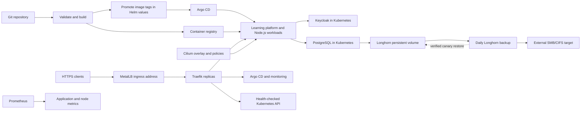

# Platform architecture

Changes start in Git. GitHub Actions checks platform changes and tests and smoke-tests the Go learning platform and Node.js service. Successful images are tagged with the source commit, published with provenance, and promoted in Helm values. Argo CD watches `main` and applies the changes. Terraform manages selected platform releases; Argo CD owns the workloads.

The application delivery workflow follows this path:

- GitHub Actions tests the Go packages, starts a temporary PostgreSQL database, and smoke-tests the built Go image before publishing it. Node.js keeps its own build and smoke test.
- Each image tag is tied to the source commit. The workflow updates the Helm value, then Argo CD reconciles the new image.
- The post-deployment workflow checks public health and sign-in routes, verifies the account API rejects unsigned requests, and checks application targets through Prometheus when its Basic Auth secret is available.

The Go metrics endpoint is exposed on a separate Service port that is reachable from Prometheus inside the cluster. It is not exposed through the public Ingress. The Keycloak administration console is also kept off the public route and is reached through a temporary Kubernetes port-forward.

Each VM runs the Kubernetes control plane as well as application workloads. The three etcd members need two members to keep quorum, so the cluster can tolerate one member going down. Two unavailable members stop control-plane writes.

MetalLB advertises the shared service address. Traefik terminates public application TLS and forwards Kubernetes API TLS without termination. Its API backend checks all control-plane node addresses. API TLS authentication and authorization remain with Kubernetes.

Cilium agents and operators contact their own node's API using `status.hostIP`. Kubelet configurations likewise use local APIs. Cilium allocates pod addresses from its own cluster pool independently of legacy node podCIDR metadata. Kube-proxy handles Kubernetes Services.

The policies in `networking/policies/` cover the Node.js service and allow only the Prometheus server to reach Longhorn manager metrics on TCP 9500. The learning platform chart applies namespace policies to its app, Keycloak, and database Pods. Hubble is available for inspecting pod traffic. These policies do not cover every infrastructure namespace.

The Argo CD HA profile runs multiple HTTP servers, repository servers and Redis instances. Node Exporter runs on each node. Prometheus, Grafana and Alertmanager keep their data on Longhorn volumes, which are backed up to the external SMB share.
