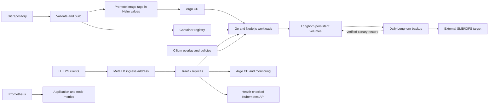

# Platform architecture

Changes start in Git. GitHub Actions checks platform changes and builds and smoke-tests the Go and Node.js apps. Successful images are tagged with the source commit, published with provenance, and promoted in the Helm values. Argo CD watches `main` and applies the changes. Terraform manages selected platform releases; Argo CD owns the workloads.

The deployed app images show this path end to end:

- Build source revision: [`002200d`](https://github.com/egyhaty/karm-devops/commit/002200d484b62e1104821a93d6d212f50b97ed90).
- [GitHub Actions run 49](https://github.com/egyhaty/karm-devops/actions/runs/38869857895) built and smoke-tested both images, published them, and created signed provenance attestations for their registry digests.
- Image promotion commit: [`e91fb33`](https://github.com/egyhaty/karm-devops/commit/e91fb33ffccaaaa690c20eb1b658dd2ffa6e474b), recording `sha-002200d` for both applications.
- Argo CD reconciled the Helm values; the live applications report Synced/Healthy with three ready replicas each.

The [post-deployment workflow](https://github.com/egyhaty/karm-devops/actions/workflows/post-deployment-check.yml) checks the public app health and metrics endpoints after image promotion. If `PROMETHEUS_BASIC_AUTH` is set in GitHub Actions, it also checks that both app targets are up in Prometheus.

Each VM runs the Kubernetes control plane as well as application workloads. The three etcd members need two members to keep quorum, so the cluster can tolerate one member going down. Two unavailable members stop control-plane writes.

MetalLB advertises the shared service address. Traefik terminates public application TLS and forwards Kubernetes API TLS without termination. Its API backend checks all control-plane node addresses. API TLS authentication and authorization remain with Kubernetes.

Cilium agents and operators contact their own node's API using `status.hostIP`. Kubelet configurations likewise use local APIs. Cilium allocates pod addresses from its own cluster pool independently of legacy node podCIDR metadata. Kube-proxy handles Kubernetes Services.

The policies in `networking/policies/` cover the two demo apps and allow only the Prometheus server to reach Longhorn manager metrics on TCP 9500. Hubble is available for inspecting pod traffic. These policies do not cover every infrastructure namespace.

The Argo CD HA profile runs multiple HTTP servers, repository servers and Redis instances. Node Exporter runs on each node. Prometheus, Grafana and Alertmanager keep their data on Longhorn volumes, which are backed up to the external SMB share.
