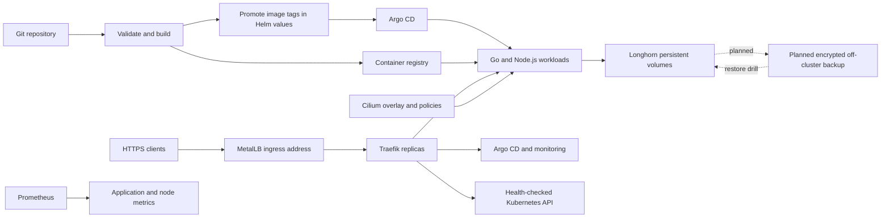

# Platform architecture

Git stores desired configuration. GitHub Actions validates configuration, smoke-tests application images, publishes commit-tagged images with signed build provenance, and promotes them through Helm values; Argo CD reconciles application resources. Terraform manages selected infrastructure releases through an explicitly maintained state.

The current desired application images provide a traceable delivery example:

- Application source commit: [`84e3c1b`](https://github.com/egyhaty/karm-devops/commit/84e3c1bba9adb58b61a206b9bae0b13bdc271be4) (`feat: migrate platform to three-node Cilium networking and HA ingress`).
- Image promotion commit: [`c747522`](https://github.com/egyhaty/karm-devops/commit/c7475227cbf7c486e3a577d88f8b8f653777e795), which records both application tags as `sha-84e3c1b`.
- GitHub Actions builds and smoke-tests each image before publishing; the promoted Helm values are reconciled by Argo CD.

Each node runs an API server, controller manager, scheduler, etcd member and application workloads. Three etcd members require two healthy members for quorum. Losing one member can preserve Kubernetes state availability; losing two cannot.

MetalLB advertises the shared service address. Traefik terminates public application TLS and forwards Kubernetes API TLS without termination. Its API backend checks all control-plane node addresses. API TLS authentication and authorization remain with Kubernetes.

Cilium agents and operators contact their own node's API using `status.hostIP`. Kubelet configurations likewise use local APIs. Cilium allocates pod addresses from its own cluster pool independently of legacy node podCIDR metadata. Kube-proxy handles Kubernetes Services.

Application network policies allow ingress from Traefik, monitoring and peer workloads. Egress permits DNS and application peers; unrelated egress is denied. Hubble provides internal traffic visibility. Infrastructure namespaces retain upstream network policy settings.

The Argo CD HA profile replicates HTTP servers, repository servers and Redis. Monitoring runs node exporters on all nodes; Prometheus, Grafana and Alertmanager use Longhorn persistent volumes. Volume replication supports availability across Kubernetes nodes but does not provide an off-cluster backup or full failure-domain independence.
