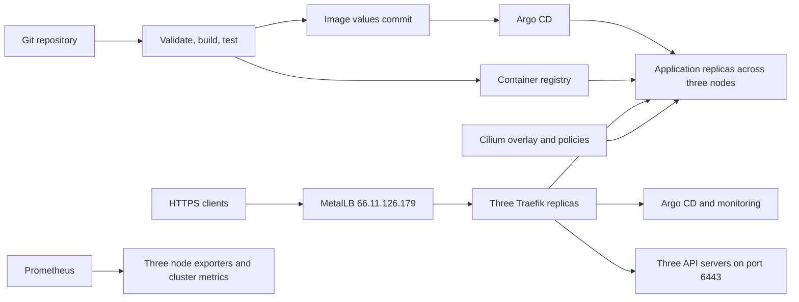

# Platform Architecture

Git stores desired configuration. GitHub Actions validates configuration and tests images; Argo CD reconciles application resources. Terraform manages Cilium, Traefik, MetalLB and other existing infrastructure releases through an explicitly maintained state.

Each node runs an API server, controller manager, scheduler, etcd member and application workloads. Three etcd members require two healthy members for quorum. Losing one member can preserve Kubernetes state availability; two-member loss cannot.

MetalLB advertises the shared service address. Traefik terminates public application TLS and forwards Kubernetes API TLS without termination. Its file-provider API backend lists all three node addresses and checks TCP health every two seconds. API TLS authentication and authorization remain with Kubernetes.

Cilium agents and operators contact their own node's API using `status.hostIP`. Kubelet configurations likewise use local APIs. This removes the bootstrap dependency on Traefik pods. Cilium allocates actual pod addresses from 10.245.0.0/16 independently of legacy node podCIDR metadata. Services retain 10.96.0.0/12. Kube-proxy handles Kubernetes Services.

Application network policies allow ingress from Traefik, monitoring and peer workloads. Egress permits DNS and application peers; unrelated egress is denied. Hubble provides internal traffic visibility. Infrastructure namespaces retain upstream network policy settings.

The Argo CD HA profile replicates HTTP servers, repository servers and Redis. Controller and identity components still follow upstream singleton settings. Monitoring runs node exporters on all nodes; Prometheus, Grafana and Alertmanager use Longhorn persistent volumes replicated across Kubernetes nodes. Volume replication improves availability but is not an off-cluster backup or full failure-domain independence.
