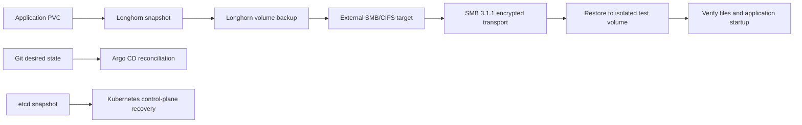

# Storage and recovery

## Kubernetes persistent storage

Longhorn is installed by Argo CD from `argocd/apps/longhorn.yaml`; chart values are in `storage/longhorn/values.yaml`. Each Kubernetes VM contributes a dedicated virtual disk mounted in the guest at `/var/lib/longhorn`. The default StorageClass uses three replicas with hard node anti-affinity and a `Retain` reclaim policy.

The Longhorn UI is internal, and Prometheus scrapes Longhorn through a ServiceMonitor. Replicas keep a volume available when a Kubernetes node fails. They do not protect against losing the cluster or its physical host; the SMB backups provide the off-cluster copy.

## Backup policy and current state

A manually created encrypted migration archive was checksum-checked and stored outside the cluster. It contains a copy of the cluster recovery material and monitoring data from the migration. Its decryption key is stored separately from the archive.

Longhorn 1.13 writes to an external SMB/CIFS share. The share address is set in the cluster's `longhorn-default-resource` ConfigMap, so it does not appear in this public repo. Argo CD ignores that one ConfigMap field to preserve the setting. The encrypted credentials are in `sealed-secrets/longhorn/backup-credentials.yaml`; Sealed Secrets creates the usable Secret in `longhorn-system`.

The `daily-backup` job runs at 01:00 and keeps seven backups per volume. It applies to volumes that do not have another recurring job. The restore test used a temporary 1 GiB volume, restored its backup to a separate Longhorn volume, and checked the test file before removing the test resources. SMB 3.1.1 encrypts the transfer. The default StorageClass is unencrypted, so Longhorn does not encrypt the backup data at rest; disk encryption on the backup server has not been verified. Longhorn covers PVC data. The etcd snapshot covers Kubernetes control-plane state.

## Recovery flow

To restore app data, restore the Longhorn backup to a separate volume, check it, then attach it to the workload. For control-plane recovery, use the etcd restore procedure for the Kubernetes version that created the snapshot. The migration archive's key is kept separately from the archive.
