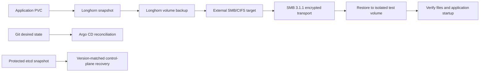

# Storage and recovery

## Kubernetes persistent storage

Longhorn is installed by Argo CD from `argocd/apps/longhorn.yaml`; chart values are in `storage/longhorn/values.yaml`. Each Kubernetes VM contributes a dedicated virtual disk mounted in the guest at `/var/lib/longhorn`. The default StorageClass uses three replicas with hard node anti-affinity and a `Retain` reclaim policy.

The Longhorn UI is internal. Prometheus scrapes Longhorn metrics through a ServiceMonitor. Replication improves availability across Kubernetes nodes, but it is not an off-cluster backup and does not make a single-replica application highly available.

## Backup policy and current state

A manually created, encrypted migration archive was checksum-verified and stored outside the cluster. It covered cluster recovery material and monitoring data at that point in time. The archive and its decryption key are kept outside this repository; their storage locations and contents are intentionally not published.

Longhorn 1.13 uses an external SMB/CIFS backup target. The endpoint is kept in the cluster's `longhorn-default-resource` ConfigMap and is intentionally omitted from public Git. Argo CD ignores only that target data field so Helm reconciliation preserves the operator-managed value. CIFS credentials are managed by the SealedSecret in `sealed-secrets/longhorn/backup-credentials.yaml`; the resulting Secret is in `longhorn-system`.

The `daily-backup` recurring job runs at 01:00 and retains the latest seven backups per volume. Its `default` group covers volumes without another recurring job. On 2026-10-16, a temporary 1 GiB canary volume was backed up to SMB, restored to a separate Longhorn volume, and its test file verified; the temporary Kubernetes resources and canary backup were then removed. SMB 3.1.1 encryption (`seal`) protects traffic in transit. The default StorageClass is unencrypted, so Longhorn does not encrypt these backups at rest; encryption on the external server was not verified. Longhorn volume backups cover PVC contents; Kubernetes control-plane state needs a separate etcd recovery procedure.

## Recovery flow

Never restore an etcd snapshot over a healthy cluster. Use the Kubernetes and etcd recovery procedure matching the snapshot version. Keep decryption material separate from the backup payload and test access through the documented recovery procedure.
