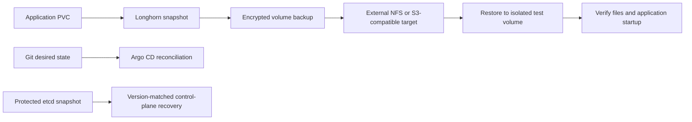

# Storage and recovery

## Kubernetes persistent storage

Longhorn is installed by Argo CD from `argocd/apps/longhorn.yaml`; chart values are in `storage/longhorn/values.yaml`. Each Kubernetes VM contributes a dedicated virtual disk mounted in the guest at `/var/lib/longhorn`. The default StorageClass uses three replicas with hard node anti-affinity and a `Retain` reclaim policy.

The Longhorn UI is internal. Prometheus scrapes Longhorn metrics through a ServiceMonitor. Replication improves availability across Kubernetes nodes, but it is not an off-cluster backup and does not make a single-replica application highly available.

## Backup policy and current state

A manually created, encrypted migration archive was checksum-verified and stored outside the cluster. It covered cluster recovery material and monitoring data at that point in time. The archive and its decryption key are kept outside this repository; their storage locations and contents are intentionally not published.

Longhorn currently has no configured backup target or recurring backup jobs. The available external destination is SMB-only, while Longhorn's native backup target requires an NFS export or an S3-compatible endpoint. No unsupported bridge or unverified schedule is configured. Enable NFS or an S3-compatible target on the backup service, then configure the endpoint and credentials through protected cluster secrets before declaring automated volume backups active.

The intended policy is encrypted daily backups with a 7-day retention window, followed by a restore drill to a separate test volume. Longhorn volume backups cover PVC contents; Kubernetes control-plane state needs a separate etcd recovery procedure. A completed backup is not considered proven until a restore has been mounted and verified.

## Recovery flow

Never restore an etcd snapshot over a healthy cluster. Use the Kubernetes and etcd recovery procedure matching the snapshot version. Keep decryption material separate from the backup payload and test access through the documented recovery procedure.
