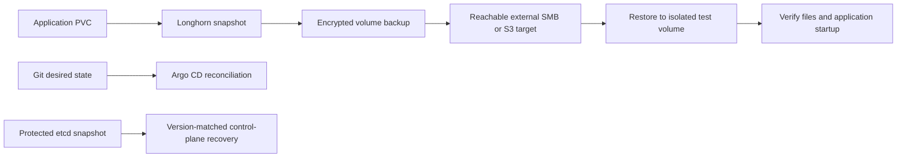

# Storage and recovery

## Kubernetes persistent storage

Longhorn is installed by Argo CD from `argocd/apps/longhorn.yaml`; chart values are in `storage/longhorn/values.yaml`. Each Kubernetes VM contributes a dedicated virtual disk mounted in the guest at `/var/lib/longhorn`. The default StorageClass uses three replicas with hard node anti-affinity and a `Retain` reclaim policy.

The Longhorn UI is internal. Prometheus scrapes Longhorn metrics through a ServiceMonitor. Replication improves availability across Kubernetes nodes, but it is not an off-cluster backup and does not make a single-replica application highly available.

## Backup policy and current state

A manually created, encrypted migration archive was checksum-verified and stored outside the cluster. It covered cluster recovery material and monitoring data at that point in time. The archive and its decryption key are kept outside this repository; their storage locations and contents are intentionally not published.

Longhorn 1.13 supports SMB/CIFS backup targets directly. The existing external SMB destination is mounted and readable from Proxmox, but a read-only TCP/445 connectivity check from the Kubernetes VM could not reach it. The Longhorn target and recurring jobs are therefore not configured. Do not publish the destination address or share path. Before enabling backups, provide TCP/445 access from the Kubernetes nodes or choose another supported target reachable from those VMs; then store CIFS credentials in a Kubernetes Secret in `longhorn-system`.

The default StorageClass does not encrypt volumes. Longhorn encrypts backups made from encrypted volumes, so encrypted backup coverage requires the monitoring PVCs to use an encrypted StorageClass and node-side encryption support. After network reachability is available, the intended policy is a daily recurring backup with age-based retention of `168h` (seven days), followed by a restore drill to an isolated test volume. These backups do not exist yet, and no restore drill has been completed. Longhorn volume backups cover PVC contents; Kubernetes control-plane state needs a separate etcd recovery procedure. A completed backup is not proven until a restore has been mounted and verified.

## Recovery flow

Never restore an etcd snapshot over a healthy cluster. Use the Kubernetes and etcd recovery procedure matching the snapshot version. Keep decryption material separate from the backup payload and test access through the documented recovery procedure.
